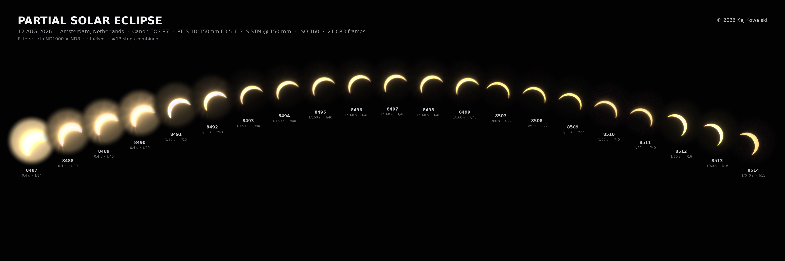

# Solar Eclipse

Photographs and a portable RAW analysis pipeline for the 12 August 2026 solar eclipse in Amsterdam.



## Outputs

- [`eclipse_progression_amsterdam_urth_final_4k.png`](final/eclipse_progression_amsterdam_urth_final_4k.png) - lossless 3840x1280 final
- [`eclipse_progression_amsterdam_urth_final_1920.jpg`](final/eclipse_progression_amsterdam_urth_final_1920.jpg) - 1920x640 JPEG preview

Diagnostic and processed images live in [`analysis/renders/`](analysis/renders/).

## Run the Pipeline

Requirements:

- Python 3.14
- [uv](https://docs.astral.sh/uv/)
- [ExifTool](https://exiftool.org/) for metadata propagation

Install the locked Python environment:

```bash
uv sync
```

With local RAW ZIP inputs under `source/raw-archives/`, run the complete pipeline from the repository root:

```bash
uv run solar-eclipse-analysis all
```

Run individual stages:

```bash
uv run solar-eclipse-analysis extract
uv run solar-eclipse-analysis inventory
uv run solar-eclipse-analysis analyze
uv run solar-eclipse-analysis edge-spread
uv run solar-eclipse-analysis render
```

`analyze` writes per-frame crops to `analysis/crops/`. `render` writes processed images to `analysis/renders/` and regenerates both final progression files in `final/`.

Generated PNG and JPEG files preserve portable source EXIF/XMP metadata, including authorship, copyright, camera, lens, capture time, exposure, metering, flash, white balance, sensor resolution, ratings, and subjects. Composite images retain shared camera settings and omit conflicting exposure values.

GPS/location data, serial numbers, unique identifiers, firmware, device telemetry, embedded previews, filesystem data, CR3 container fields, and Canon MakerNotes are not copied. Generated metadata records the output dimensions, color space, description, software, and source filenames.

Run tests:

```bash
uv run pytest
```

All paths default to locations inside the current project root. Use `--root` to run against another checkout, or override individual locations with `--archives`, `--raw`, `--crops`, `--renders`, and `--final`. Relative overrides resolve against `--root`; absolute paths also work.

```bash
uv run solar-eclipse-analysis \
  --root /path/to/project \
  --raw /path/to/cr3-files \
  inventory
```

## Layout

- `final/` - finished 4K PNG and 1920px JPEG compositions
- `analysis/renders/` - generated diagnostic and processed images
- `analysis/crops/` - generated per-frame analysis crops (not tracked)
- `source/raw/` - external Canon CR3 input (not included)
- `source/raw-archives/` - external RAW ZIP input used by `extract` (not included)
- `src/solar_eclipse_analysis/` - maintained Python package and CLI pipeline

Inventory, metrics, edge measurements, and alignment transforms pass directly between pipeline stages in memory. Historical files under `analysis/data/` may remain locally but are not read, regenerated, or tracked.

## License

The software source code, tests, and software configuration are available under the MIT License. Photographs, RAW images, renders, montages, contact sheets, compositions, and all other visual works are **not** MIT-licensed: © 2026 Kaj Kowalski, All Rights Reserved. See [`LICENSE.md`](LICENSE.md) for the complete terms.
